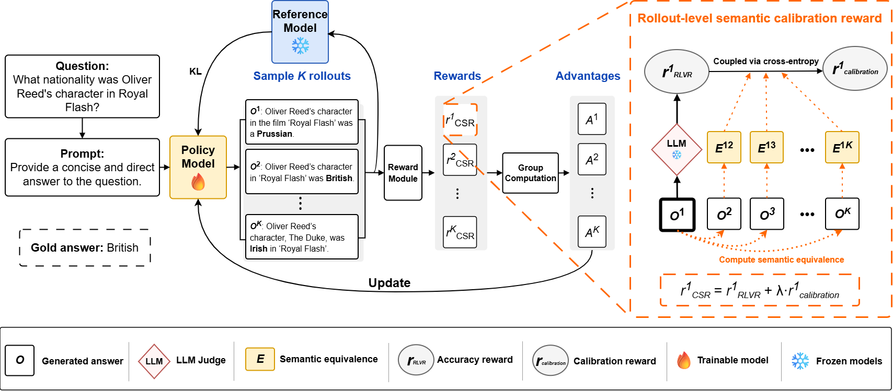

<h1 align="center">Calibrating LLMs with Semantic-level Reward</h1>
<p align="center">
    <a href="https://arxiv.org/abs/2605.15588">  </a>
    
</p>

Hi, this is the code for our NeurIPS 2026 paper:
*[Calibrating LLMs with Semantic-level Reward](https://arxiv.org/abs/2605.15588)*.



**Overview of CSR.** For each question $x$ we draw $K$ rollouts from the policy
$\pi_\theta$, score each rollout with a verifiable correctness reward
$r_{\mathrm{RLVR}}$ and a semantic calibration reward $r_{\mathrm{Calibration}}$, and
update the policy via group-relative advantages. CSR concentrates correct rollouts into
a tight semantic cluster while keeping incorrect rollouts dispersed, so that semantic
agreement among sampled outputs becomes an informative signal of correctness.

Confidence is read off the rollouts as `c(x) = exp(-SE(x))`, the exponential of the
semantic entropy, so the model never emits a confidence token. Both reward terms live
on `[0, 1]`, which makes their weights directly comparable.

This repository holds the training code, the evaluation code, and the post-hoc
estimators reported in the appendix.

| Path | What it is |
| --- | --- |
| `csr/` | The library: rewards, semantic clustering, judge client, config loader, metrics |
| `train/` | One trainer per method: `train_CSR.py`, `train_RLVR.py`, `train_RLCR.py`, `train_RD.py` |
| `evaluation/` | `eval_semantic.py` (sampling-based) and `eval_verbalized.py` (verbalized-confidence baselines) |
| `configs/` | YAML defaults, split into `methods/`, `models/`, `datasets/`, plus `judge.yaml` |
| `analysis/` | Post-hoc estimators and aggregation rules reported in the appendix |
| `scripts/` | `serve/serve_judge.sh` (local judge) and `f1_judge_eval.py` (token-F1 clustering) |
| `rd_util/` | Utilities for the Rewarding-Doubt baseline, kept close to upstream |

# Getting started

## 1. Setup Environment

We conducted all experiments on NVIDIA A100 80GB PCIe GPUs. Each training or
evaluation run uses a single GPU. The software environment is Python 3.11.14,
PyTorch 2.9.0 and CUDA 12.8.

To install the dependencies, run:

```bash
conda create -n csr python=3.11 && conda activate csr
pip install torch==2.9.0            # first, and matching your CUDA
pip install -r requirements.txt
```

`requirements.txt` pins every direct dependency at the version the reported runs
used. Install `torch` by itself first: the stack is version-sensitive, and letting
pip resolve it alongside the rest can silently substitute a different build.

The Rewarding-Doubt baseline pins an older stack (Python 3.10.20, PyTorch 2.5.1,
CUDA 12.4), so it gets a second environment. Use it only for `train_RD.py`:

```bash
conda create -n csr-rd python=3.10 && conda activate csr-rd
pip install torch==2.5.1
pip install -r requirements-rd.txt
```

## 2. Setup the Judge

CSR's reward and every sampling-based evaluation call an LLM judge for two questions:
whether an answer matches the gold answer, and whether two answers mean the same thing.
A judge must be reachable before any run starts.

The default judge is GPT-4.1-nano on the OpenAI API. It only needs a key:

```bash
export OPENAI_API_KEY=sk-...
```

To use a local judge such as gpt-oss-20b, serve it with vLLM:

```bash
export OPENAI_API_KEY=EMPTY     # ignored by a local server, but the code requires it
bash scripts/serve/serve_judge.sh 0 8310 openai/gpt-oss-20b   # GPU, port, model
```

Then add these overrides to any training or evaluation command:

```bash
--set judge.base_url=http://127.0.0.1:8310/v1 --set judge.model_id=gpt-oss-20b \
--set judge.reasoning_effort=low --set judge.max_tokens=1024
```

gpt-oss-20b needs `reasoning_effort` and the larger `max_tokens`. Drop both for a
non-reasoning model.

## 3. Prepare Datasets

Datasets download from the HuggingFace Hub on first use and are cached under `HF_HOME`
(default `~/.cache/huggingface`). Checkpoints and evaluation results are written inside
the repository:

```
.
├── ckpt            # ckpt/<METHOD>/<run>/checkpoint-<step>
└── results         # results/<run>/{config.yaml,results.json,results.csv}
```

| | Available |
| --- | --- |
| Methods | `Base` `CSR` `RLVR` `RLCR` `RD` |
| Models | `llama` `qwen` `mistral` `qwen14b` `qwen32b` |
| Datasets | `hotpot` `hotpot_context` `trivia` `msmarco` `nq_open` `musique` `2wiki_comp` |

## 4. Train

Each method has its own entry point with the same arguments:

```bash
export CUDA_VISIBLE_DEVICES=0
export OPENAI_API_KEY=EMPTY

python train/train_CSR.py --model qwen --dataset hotpot [--set key=value ...]
```

`train_RLVR.py` and `train_RLCR.py` run in the main environment. `train_RD.py` runs in
the environment built from `requirements-rd.txt`.

### 4.1 CSR

The calibration weight ramps from 0.8 to 1.2 on a sigmoid by default, and the
correctness weight `corr_w` is 1.0. To keep the calibration weight constant:

```bash
python train/train_CSR.py --model qwen --dataset hotpot \
  --set method.train.cali_w_start=1.0 --set method.train.cali_w_end=1.0
```

`cali_w_schedule` can also be `linear`. `configs/methods/csr.yaml` notes the weights at
which training becomes unstable.

### 4.2 RD

`configs/methods/rd.yaml` follows the upstream Rewarding-Doubt release, except for LoRA
rank 32 (upstream uses 8) and an F1@0.5 correctness reward (upstream uses exact match).
The RD rows in the paper use:

```bash
python train/train_RD.py --model qwen --dataset hotpot \
  --set method.train.confidence_stop=true --set method.train.strict_format=true \
  --set method.train.learning_rate=1e-5 --set method.train.batch_size=8 \
  --set method.train.ppo_temperature=1.0 --set method.train.ppo_repetition_penalty=1.0
```

To save memory, the 32B run sets `method.train.ppo_mini_batch_size=2` and
`method.train.ppo_gradient_accumulation_steps=2`. `hotpot_context` sets them to 1 and 4
and adds `method.train.unpadded_generation=true`. The Qwen3 models (`qwen14b`, `qwen32b`) need
`transformers>=4.51.3` and `unsloth>=2025.4.7` in the RD environment.

## 5. Evaluate

Each run writes `results/<run>/{config.yaml,results.json,results.csv}`. Use
`--exp-name` to give each run its own directory.

### 5.1 Base, RLVR and CSR

`evaluation/eval_semantic.py` samples 16 answers per question and reads confidence from
their semantic agreement:

```bash
python evaluation/eval_semantic.py --method Base --model qwen --dataset hotpot
python evaluation/eval_semantic.py --method CSR --model qwen --dataset hotpot \
  --ckpt ckpt/CSR/<run>/checkpoint-2500
```

For a full table row, loop over the four datasets:

```bash
for ds in hotpot trivia msmarco nq_open; do
  python evaluation/eval_semantic.py --method CSR --model qwen --dataset "$ds" --ckpt "$CKPT"
done
```

### 5.2 RD and RLCR

`evaluation/eval_verbalized.py` parses the confidence the model states:

```bash
python evaluation/eval_verbalized.py --method RD --model qwen --dataset hotpot \
  --ckpt ckpt/RD/<run>/model_finetuned_step_1250
python evaluation/eval_verbalized.py --method RLCR --model qwen --dataset hotpot \
  --ckpt ckpt/RLCR/<run>/checkpoint-2500
```

### 5.3 Token F1 in place of the judge

Setting `--set judge.equivalence=f1` replaces the pairwise equivalence calls with token
F1. Correctness is still judged by the LLM. `scripts/f1_judge_eval.py` re-clusters
finished CSR runs this way at the paper's thresholds (0.50 for Llama and Mistral, 0.80
for Qwen) and writes each result to a separate `*_semf1_k16` run:

```bash
python scripts/f1_judge_eval.py
```

### 5.4 Post-hoc estimators

These scripts re-score finished runs in `results/` without a GPU:

| Script | Reports |
| --- | --- |
| `analysis/estimators.py` | Semantic Density and SIMBA-UQ's Bayesian aggregation |
| `analysis/aggregation.py` | SIMBA-UQ's arithmetic aggregation and the `clf-pairs+gen` classifier |
| `analysis/selective.py` | Selective prediction (AURAC, AUGRC) |

Semantic Density and `clf-pairs+gen` also use the mean token log-probability of each
answer. Compute it once per run on a GPU:

```bash
python analysis/logprobs_hf.py --model qwen --method CSR --datasets hotpot trivia
```

Without it, Semantic Density uses uniform weights and `clf-pairs+gen` uses similarities
only. `analysis/aggregation.py --no-logprobs` forces the latter. The scripts find runs by
name, so edit `analysis/runs.py` to match your run names first.

## 6. Configuration

Configs load in this order, each overriding the previous one: `default.yaml`,
`judge.yaml`, the model, the method, the dataset. `--set key=value` on the command line
overrides all of them.

---

# References

If you find this code helpful in your research, please consider citing

```bibtex
@inproceedings{csr2026calibrating,
title={Calibrating LLMs with Semantic-level Reward},
author={Yu, Fengfei and Niu, Ruijia and Wu, Dongxia and Ma, Yian and Yu, Rose},
booktitle={NeurIPS},
year={2026}
}
```

# Implementation Credits

Some of our implementations rely on other repos. We want to thank the authors
([RLCR](https://github.com/damanimehul/RLCR),
[Rewarding Doubt](https://github.com/pasta99/RewardingDoubt),
[unsloth](https://github.com/unslothai/unsloth),
[TRL](https://github.com/huggingface/trl) and
[vLLM](https://github.com/vllm-project/vllm)) for making their code publicly
available.😄
